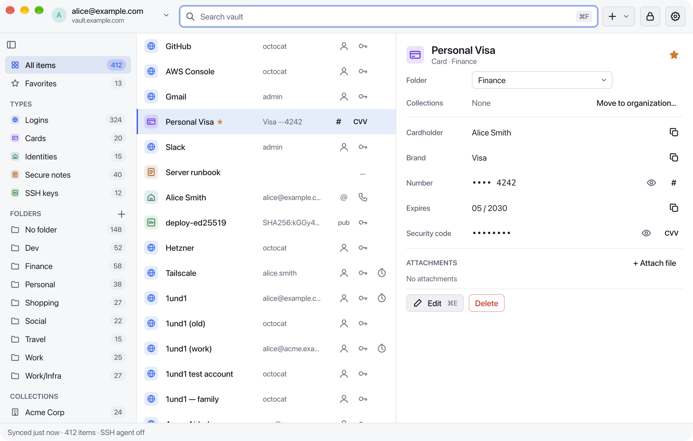
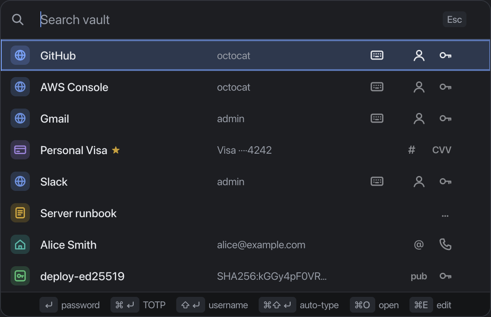
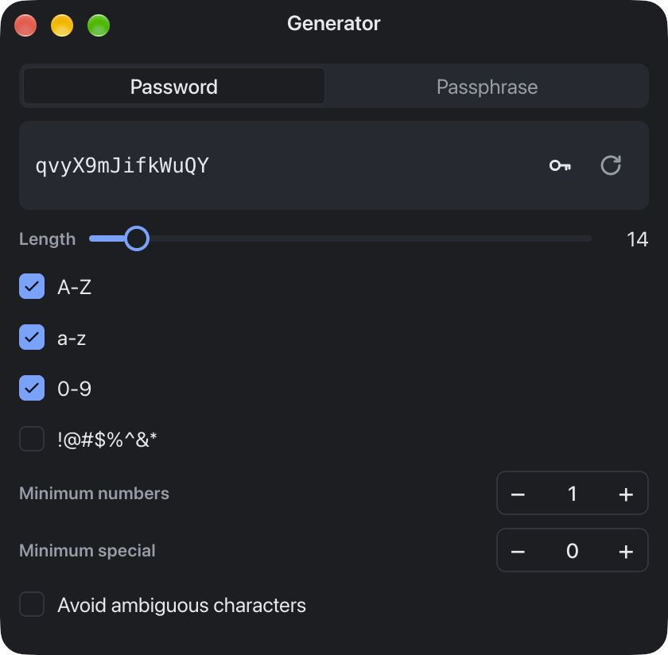

# Vaultkeeper

<p align="center">
  
</p>

Vaultkeeper is a lightweight native desktop client for self-hosted
[Vaultwarden](https://github.com/dani-garcia/vaultwarden) servers, which speak the Bitwarden API. It is written in Rust with a
[Slint](https://slint.dev) UI, runs in the system tray, and opens a window only when you need one.

**Supported platforms:** macOS 13+ on Apple silicon, Windows 11 24H2+ on x64 and ARM64, and Linux on Wayland
(GNOME, KDE Plasma, Sway and Hyprland on the latest Ubuntu and Fedora, and Arch Linux) on x86_64 and ARM64. See
[Linux](#linux) for what differs there.

Vaultkeeper is an independent project. It is **not affiliated with, endorsed by or supported by Bitwarden Inc. or the
Vaultwarden project**. It is tested against Vaultwarden 1.37.5 (see `tests/e2e/compose.yaml`).

## Screenshots

<picture>
  <source media="(prefers-color-scheme: dark)" srcset="docs/screenshots/manager-dark.png">
  
</picture>

<table>
  <tr>
    <td width="57%"></td>
    <td width="43%"></td>
  </tr>
  <tr>
    <td align="center">Quick Panel</td>
    <td align="center">Password generator</td>
  </tr>
</table>

Screenshots show the demo vault (`vaultkeeper --mock`).

## Why not Bitwarden Desktop?

- **No Electron.** Electron apps ship a full Chromium and Node.js runtime. Vaultkeeper is a single Rust binary.
- **No JavaScript.** The UI is written in Slint and drawn by its software renderer, with no web view.
- **Small memory footprint.** A background daemon owns the tray icon, the vault, sync and the SSH agent. App windows run in a
  separate UI process of the same binary, which exits about 120 s after the last window closes. When no window is open, memory
  stays at the tray-only level.
- **Fast, native Rust.** Crypto, networking and the vault logic are plain Rust, and the Quick Panel stays warm for 120 s
  after use so repeated opens are instant.

The two-process design exists because the window's memory is not fully returned after it closes (about 42 MB 10 s after the
spike's window was dropped). See the "Step 0 result" section of
[docs/solutions/vaultkeeper-architecture.md](docs/solutions/vaultkeeper-architecture.md).

## Features

- Quick Panel with a global hotkey and fuzzy search: copy password, username or TOTP code from the keyboard
- Manager window: folders, organizations and collections, moving items into an organization or between collections,
  attachments, trash
- Send: share text or a file up to 100 MB through an encrypted, self-deleting link (optional password and view limit)
- TOTP codes with a countdown
- Password and passphrase generator, from the tray or its own hotkey
- Auto-type of username and password into the previous app (key presses, no clipboard)
- SSH agent for the vault's SSH keys, with approval prompts and optional biometric verification
- Read-only [CLI access](#cli-access) for individual logins you choose to share
- Chrome, Edge and Firefox extension that fills and saves logins through native Vaultkeeper windows (see `docs/USAGE.md`)
- Quick unlock with Touch ID on macOS or Windows Hello on Windows
- Multiple accounts
- Offline mode from an encrypted local cache
- Live sync over the server websocket
- Clipboard auto-clear, and copied secrets are hidden from clipboard history
- Start at login (tray only)

## Requirements

- macOS 13 or newer on Apple silicon, Windows 11 version 24H2 or newer on x64 or ARM64, or a Wayland session of
  GNOME, KDE Plasma, Sway or Hyprland on the latest Ubuntu or Fedora, or on Arch Linux (no X11)
- A Vaultwarden server, or use `--mock` to try the demo vault

## Install

### macOS

With [Homebrew](https://brew.sh):

```sh
brew install --cask avbel/tap/vaultkeeper
```

The cask installs `/Applications/Vaultkeeper.app`; step 2 below still applies to the first launch. The app keeps
updating itself, so `brew upgrade` skips it unless you pass `--greedy`. Or install by hand:

1. Download `Vaultkeeper-<version>-arm64.dmg` from [Releases](https://github.com/avbel/vaultkeeper/releases), open it and
   drag Vaultkeeper to Applications. Do this before the first launch: an app started from Downloads runs from a temporary
   path, and the browser extension cannot find it there.
2. The app is signed with a self-signed certificate, not an Apple Developer ID, so macOS refuses the first launch with
   "Apple could not verify…". Open it once, then choose **Open Anyway** in System Settings → Privacy & Security, or run
   `xattr -dr com.apple.quarantine /Applications/Vaultkeeper.app`. From version 0.1.7 on, only the first install
   needs this: later versions install from the tray or automatically (see "Updates" in [docs/USAGE.md](docs/USAGE.md)).

### Windows

Download `Vaultkeeper-v<version>-x64-setup.exe` or `Vaultkeeper-v<version>-arm64-setup.exe` for your PC from
[Releases](https://github.com/avbel/vaultkeeper/releases), run the installer, and open Vaultkeeper from the Start menu.
For portable use, extract the matching ZIP and run `vaultkeeper.exe`.

### Linux

With [Homebrew](https://brew.sh) on Linux:

```sh
brew install avbel/tap/vaultkeeper
vaultkeeper   # once: writes the launcher entry
```

Vaultkeeper links the desktop's own libraries; install them if they are missing:

- Ubuntu: `sudo apt install libxkbcommon0 libwayland-client0 libegl1 libfontconfig1 libudev1`
- Fedora: `sudo dnf install libxkbcommon libwayland-client mesa-libEGL fontconfig systemd-libs`

Updates come from `brew upgrade vaultkeeper`; the app's own updater is off for a Homebrew install. Each release also
has `vaultkeeper-v<version>-x86_64-unknown-linux-gnu.tar.gz` and `…-aarch64-unknown-linux-gnu.tar.gz`. Debian and RPM
packages are planned.

### Browser extension

Install the Vaultkeeper extension from the Chrome Web Store (Chrome and Edge) or
[Firefox Add-ons](https://addons.mozilla.org/firefox/addon/vaultkeeper-app/) and turn on browser integration in the
app's settings. Each GitHub release also carries a Mozilla-signed `vaultkeeper-firefox-v<version>.xpi`: open it in
Firefox to install the add-on without the store (its version ends in `.1`; install a newer release's `.xpi` to update it).

Each release lists SHA-256 checksums in `SHA256SUMS`.

## Build from source

`rustup` installs the Rust toolchain pinned in `rust-toolchain.toml`.

### Build on macOS

Install the Xcode Command Line Tools (`xcode-select --install`) to build the Swift shim in `crates/platform/swift`.

```sh
git clone https://github.com/avbel/vaultkeeper.git
cd vaultkeeper
scripts/make-signing-cert.sh   # once; creates a local code-signing certificate
scripts/bundle-macos.sh        # -> target/bundle/Vaultkeeper.app
ditto target/bundle/Vaultkeeper.app /Applications/Vaultkeeper.app
open /Applications/Vaultkeeper.app
```

The certificate step is optional but recommended: a stable code identity keeps keychain access and the Accessibility
permission across rebuilds. Details, including the signing prompt, are in [docs/USAGE.md](docs/USAGE.md).

To open the demo vault from a standard macOS installation, run
`/Applications/Vaultkeeper.app/Contents/MacOS/vaultkeeper --mock`.

### Build on Windows

From the repository root, use PowerShell with the Rust MSVC toolchain and Visual Studio C++ Build Tools installed.

```powershell
.\scripts\bundle-windows.ps1 -Build -Arch x64   # use arm64 for Windows on ARM
.\out\stage\vaultkeeper.exe
```

### Build on Linux

Install the development headers, then build:

- Ubuntu: `sudo apt install build-essential pkg-config libfontconfig1-dev libxkbcommon-dev libwayland-dev libdbus-1-dev libudev-dev`
- Fedora: `sudo dnf install gcc pkgconf-pkg-config fontconfig-devel libxkbcommon-devel wayland-devel dbus-devel systemd-devel`

```sh
cargo build --release
target/release/vaultkeeper
```

From macOS, `scripts/check-linux.sh` runs clippy (or, with `--test`, the tests) for the Linux build in Docker.

## Usage

Log in with your server URL, email and master password, then use the tray icon or the Quick Panel hotkey. To try the demo
vault without a server, run `vaultkeeper --mock` and use `mock` as the master password. The user guide
[docs/USAGE.md](docs/USAGE.md) covers first login, the Quick Panel keys, auto-type and the Accessibility permission, Touch ID,
the SSH agent setup, start at login, settings, files and uninstalling.

```
vaultkeeper              start (or ask the running instance) and open the vault window
vaultkeeper --tray       system tray only
vaultkeeper --search     open the Quick Panel, as its hotkey does (no vault window)
vaultkeeper --generator  open the password generator, as its hotkey does
vaultkeeper --mock       demo vault
```

### CLI access

1. Keep Vaultkeeper running and turn on **Enable CLI access** in Settings.
2. Edit each login you want to share, check **Allow CLI access**, and save. Both controls are off by default.
3. The Windows installer and Homebrew on Linux put Vaultkeeper on the `PATH`. On macOS, copy the terminal setup command
   from Settings or run the following for a standard installation. If an AI agent uses a separate shell, add Vaultkeeper
   to that shell's `PATH`.

   ```sh
   export PATH="/Applications/Vaultkeeper.app/Contents/MacOS:$PATH"
   ```

| Command | Output |
|---|---|
| `vaultkeeper list` | JSON array with a `key` and `title` for each eligible login |
| `vaultkeeper get_fields <key>` | JSON array describing non-empty fields with `field`, `label`, and `private` |
| `vaultkeeper get <key> <field> [--allow-private]` | The selected field as plain text, without an added newline |
| `vaultkeeper --help` | Usage and guidance for AI agents |
| `vaultkeeper --version` | Installed version |

The CLI uses an encrypted connection to the desktop app. Programs running as you can read opted-in logins from the active
account while it is unlocked. Logins that require a master password re-prompt are excluded. If the vault is locked,
Vaultkeeper prompts you to unlock it in the app. Unlock it, then retry the command.

Use the field ID from `get_fields` exactly as listed and refresh the list after editing the login. Fields marked
`private`, including passwords, TOTP seeds, and hidden custom fields, require `--allow-private`. The flag prevents
accidental disclosure. Privacy follows the field type, so ordinary fields such as notes can still contain secrets.
For a private value, add the flag only when piping the value directly into the intended command's stdin.
Running that command on its own can expose the value in the terminal or agent transcript. See the
[Vaultkeeper CLI skill](skills/vaultkeeper-cli/SKILL.md) for a pipeline example.

## Project layout

Cargo workspace (Rust edition 2024):

| Path | Purpose |
|---|---|
| `app/` | The `vaultkeeper` binary: Slint UI, tray, daemon and UI processes, hotkeys, auto-type |
| `crates/api` | HTTP client and wire models for the Bitwarden/Vaultwarden API |
| `crates/crypto` | Bitwarden-compatible key derivation and `EncString` crypto |
| `crates/gen` | TOTP codes and password/passphrase generation |
| `crates/ipc` | Daemon to UI process IPC over a local socket, including peer verification |
| `crates/linux` | Linux kernel and desktop probes for the security chains |
| `crates/platform` | OS integration: keychain, Touch ID, autostart, clipboard, single instance, hardening |
| `crates/ssh` | SSH agent adapter over the vendored `ssh_agent` |
| `crates/vault` | Session state, encrypted cache, decrypted views and vault operations |
| `crates/webauthn` | WebAuthn client data and the software authenticator for vault passkeys |
| `crates/win` | Windows security helpers (SDDL, named pipes) |
| `browsers/` | The Chrome, Edge and Firefox extension (TypeScript) |
| `vendor/ssh_agent` | Vendored from Bitwarden's clients repository, with patches listed in `vendor/PATCHES.md` |
| `vendor/secure_memory` | Vendored from Bitwarden's clients repository |

## Development

```sh
scripts/check.sh    # cargo fmt --check, clippy with -D warnings; also the pre-commit hook in .githooks
SLINT_BACKEND=winit-software cargo test --workspace
scripts/e2e.sh      # end-to-end tests against Docker Vaultwarden + Mailpit
```

`scripts/e2e.sh` starts a disposable Vaultwarden and Mailpit with Docker Compose, runs the vault scenarios and then the
app's own, which start a real daemon process and drive it over IPC. Docker is required.

## Security notes

- Secrets are decrypted on demand and handed out as zeroizing values; only names and other list data are decrypted at
  unlock.
- The vault cache on disk is encrypted. macOS keeps refresh tokens in the login keychain. Windows seals them with a key
  derived from the vault's user key and wraps them with DPAPI. Linux seals them with a key derived from the vault's
  user key and, where it works, `systemd-creds` (tied to the TPM when there is one); no keyring daemon is used.
- On Linux, Vaultkeeper checks at start which protections the system offers (keys kept out of swap and dumps, no
  memory reading by other programs, sealed sign-in data, connection peer checks, a private runtime folder and more)
  and refuses to start when a required one is missing. Settings → *System
  protection* and `vaultkeeper security status` show what is in use; see "System protection" in
  [docs/USAGE.md](docs/USAGE.md).
- On macOS, the daemon and UI process talk over a Unix socket with mode 0600. The daemon checks the peer's uid and code
  signature (audit token plus `SecCode`) and accepts only a UI process with its own signature. On Windows, the daemon
  creates a named pipe and passes the connected client handle to the UI process at launch.
- macOS release bundles are signed with the hardened runtime, so other processes cannot inject code into them.
- macOS updates install only when signed with the same certificate as the running app. That self-signed certificate is the
  maintainer's: its key is in the maintainer's keychain (local builds use it too) and in the release workflow's secrets,
  so either of those controls updates. Installed copies trust that one certificate: a new key would mean installing
  the next version by hand.

See the [architecture and threat model](docs/solutions/vaultkeeper-architecture.md) and the
[Windows security design](docs/solutions/windows-support.md).
Vaultkeeper has not had an independent security audit.

## Linux

Wayland only, on GNOME, KDE Plasma, Sway and Hyprland as the latest Ubuntu and Fedora ship them, and on Arch
Linux. Details are in [docs/USAGE.md](docs/USAGE.md)
and the [Linux design](docs/solutions/linux-support.md).

- **Tray:** a StatusNotifierItem icon that follows the panel's colours. GNOME shows it only with the AppIndicator
  extension (Ubuntu ships it; Fedora does not).
- **Hotkeys:** Ctrl-based, as on Windows; the Quick Panel is Ctrl+Shift+Space. GNOME and KDE register them through the
  GlobalShortcuts portal. On Sway and Hyprland, Settings shows the bind lines to add to the compositor's config.
- **Clipboard:** KDE, Sway and Hyprland take copies through Wayland data-control, marked so clipboard history skips
  them. GNOME has no data-control, so copies go through its RemoteDesktop portal, which asks once.
- **Auto-type:** the RemoteDesktop portal on GNOME and KDE, a virtual keyboard on Sway and Hyprland.
- **Lock:** on screen lock, sleep and logout through logind and the desktop's screensaver service. On Sway and
  Hyprland, make the idle daemon lock through `loginctl lock-session`.
- **Not yet:** quick unlock (fingerprint) and Debian/RPM packages. The Landlock app sandbox is available but off by
  default.

## License

GPL-3.0-only, see [LICENSE](LICENSE). The `ssh_agent` and `secure_memory` crates under `vendor/` are vendored from
Bitwarden's GPL-licensed clients repository (upstream commit recorded in `vendor/UPSTREAM.txt`); Vaultkeeper stays under the
same license.
